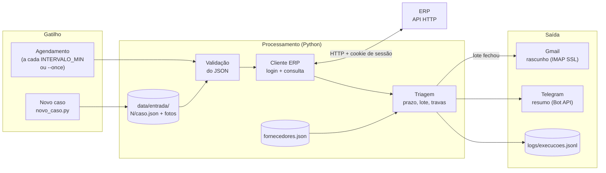
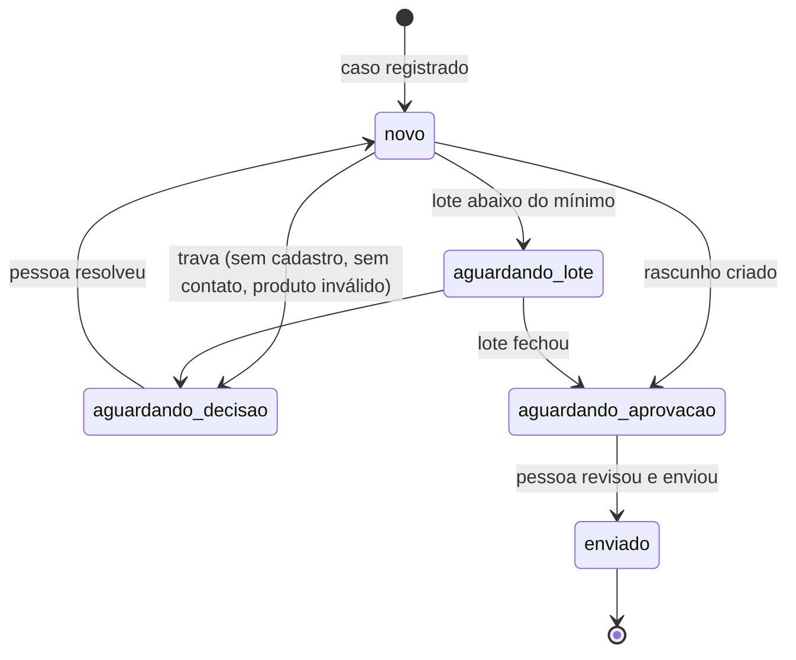

# Automação de devoluções de produtos com defeito de fábrica

Automação em Python que acompanha produtos com defeito de fábrica numa rede de lojas de calçados:
- consulta o ERP para saber de qual fábrica e de qual nota fiscal veio cada par;
- aplica as regras de cada fábrica (prazo de garantia, lote mínimo);
- quando o lote fecha, deixa pronto no Gmail o rascunho do e-mail de devolução;
- avisa o responsável no Telegram.

> Este repositório é a versão pública e didática de uma automação que roda em produção desde outubro de 2026. Dados, nomes, CNPJs e e-mails aqui são **fictícios**, e o ERP é **simulado** (`mock_erp/`), porque o real só existe na rede interna da empresa.

---

## 1. Sobre o projeto e problema resolvido

**A dor.** O cliente devolve um produto com defeito de fábrica e a loja precisa cobrar a fábrica. Feito à mão, o processo era assim:

1. o gerente manda o código do produto e a foto pelo WhatsApp;
2. alguém consulta no ERP a marca, o custo e a nota fiscal de compra;
3. confere na política daquela fábrica se ainda está no prazo e se já há pares suficientes para o lote mínimo;
4. escreve o e-mail com a referência, a numeração, a NF e as fotos de cada par.

Com várias lojas e dezenas de fábricas, cada uma com uma regra, os casos se perdiam: o prazo vencia esperando o lote fechar, o e-mail ia sem a NF certa ou o par ficava esquecido na estante.

**O que a automação faz.** Cada caso vira um arquivo JSON. De hora em hora, a automação:
- consulta o ERP dos casos novos;
- agrupa os casos por loja e fábrica;
- aplica as regras;
- monta o e-mail pronto no Gmail.

A pessoa só **revisa e clica em enviar**, e recebe no Telegram um resumo do que mudou: rascunhos prontos, lotes esperando, casos que precisam de decisão e falhas.

**Ganho prático:**
- nenhum caso fica sem dono: todo caso tem um status e aparece no resumo até ser resolvido;
- o e-mail sai padronizado e com os dados do ERP, sem redigitar;
- o prazo e o lote mínimo são conferidos por regra, não de cabeça;
- quando um sistema cai, o responsável fica sabendo na hora.

<!-- TODO (Angelo): incluir aqui o número real, ex.: "antes ~X h/semana, hoje ~Y min/semana; N casos registrados desde out/2026". -->

---

## 2. Arquitetura e fluxo de funcionamento



**Caminho dos dados (Gatilho → Processamento → Saída):**

1. **Gatilho.** O `defeitos/main.py` roda uma rodada a cada `INTERVALO_MIN` minutos, ou uma vez com `--once` (para cron, Agendador do Windows ou a demo). Os casos entram por `defeitos/novo_caso.py`, que faz o papel da recepção do WhatsApp.
2. **Leitura e validação.** O `casos.py` lê cada `caso.json` e confere os campos obrigatórios, os tipos e o status. Um arquivo ilegível ou inválido não derruba a rodada: ele aparece no resumo com o motivo.
3. **ERP.** O `erp.py` faz login (`POST /api/login`, usuário e senha do `.env`) e guarda o cookie de sessão. Depois consulta `GET /api/produtos/<código>` e valida o JSON de resposta: campos presentes, custo numérico e NF com CNPJ e data.
4. **Triagem.** O `triagem.py` acha a fábrica pelo CNPJ da NF e aplica as regras:
   - fábrica fora do cadastro ou sem e-mail → **trava** (o caso vai para decisão humana);
   - fora do prazo → **não trava**: o assunto do e-mail ganha "fora do prazo" e a fábrica decide;
   - casos da mesma loja e fábrica formam um **lote**, que só vira e-mail quando atinge o mínimo em R$ e em pares.

   O resultado é um plano em JSON: `bloquear`, `aguardarLote` e `montarRascunho`.
5. **Saída.**
   - O `gmail.py` grava o rascunho por IMAP na pasta de Rascunhos, com as fotos em anexo. **Nunca envia**: quem envia é a pessoa.
   - O `telegram.py` manda o resumo da rodada.
   - O `logs/execucoes.jsonl` registra cada rodada e cada tentativa que falhou.

**Ciclo de vida de um caso** (o status só muda pelas transições permitidas em `casos.py`):



**Quem faz o quê:**

| Etapa | Automático | Humano |
|---|---|---|
| Registrar o caso | grava `caso.json` e a foto | gerente informa código, defeito e foto |
| Dados do produto | consulta o ERP | — |
| Prazo, lote e travas | regras do `triagem.py` | decide os casos travados |
| E-mail à fábrica | monta o rascunho com anexos | **revisa e envia** |
| Acompanhamento | resumo no Telegram a cada novidade ou falha | — |

Enviar e-mail a terceiros é sempre decisão humana. A automação prepara, mas não fala em nome da empresa sozinha.

### Resiliência e tratamento de erros

| Situação | Comportamento |
|---|---|
| Timeout, conexão recusada, HTTP 5xx ou 429 | **retry com backoff** (1 s, 2 s, 4 s…) até `TENTATIVAS`; cada tentativa vai para o log |
| HTTP 4xx (senha errada, produto inexistente) | **não repete** (repetir não muda o resultado): erro claro na hora |
| Sessão do ERP expirou (401) | novo login automático e repete a consulta uma vez |
| ERP fora do ar | os casos ficam `novo` para a próxima rodada e o Telegram recebe "🚨 Falha: ERP…" |
| Gmail falhou | o lote continua pendente (sem mudar status) e entra no resumo |
| `caso.json` quebrado ou com campo faltando | o caso é ignorado com motivo no resumo; os outros seguem |
| Rodar de novo | **idempotente**: o Message-ID do rascunho vem dos protocolos do lote e é procurado antes de gravar |
| Erro inesperado | a rodada é registrada com traceback (segredos mascarados), o aviso vai ao Telegram e o agendamento continua |

### Como roda em produção

Na empresa, o mesmo fluxo roda sob um agente de IA auto-hospedado ([Hermes](https://github.com/NousResearch/hermes-agent)):
- os casos chegam por **WhatsApp**: o gerente manda código e foto, e um servidor MCP em TypeScript consulta o ERP real e grava o `caso.json`;
- o agendamento é o cron do próprio agente;
- o fluxo continua depois do e-mail: lê a resposta da fábrica, prepara a **NFD** (nota fiscal de devolução) no ERP e responde à fábrica com o DANFE e o XML.

Este repositório isola o núcleo determinístico desse fluxo (ERP → triagem → Gmail → Telegram) em Python puro, sem dados reais.

---

## 3. Tecnologias e APIs utilizadas

| Camada | Tecnologia |
|---|---|
| Linguagem | Python 3.10+ |
| HTTP | `requests` (sessão com cookie, timeout, JSON) |
| E-mail | `imaplib` + `ssl` (IMAP4 sobre TLS, porta 993), `email` (MIME com anexos) |
| Mensageria | Telegram Bot API (`sendMessage`, HTTPS) |
| Dados | JSON (casos, cadastro de fornecedores, respostas do ERP, log JSONL) |
| Credenciais | `.env` + `python-dotenv` |
| ERP simulado | `http.server` (biblioteca padrão) com login, cookie e falhas programáveis |
| Containers | Docker + Docker Compose (opcional) |
| Testes | `unittest` (22 testes, incluindo uma rodada inteira contra o ERP simulado) |

**Protocolos e serviços integrados:**
- ERP: HTTP/REST, autenticação por usuário e senha com cookie de sessão;
- Gmail: IMAP sobre SSL, autenticação Basic com **senha de app**;
- Telegram: HTTPS, **token do bot**.

**Autenticação e segredos:**
- Nenhuma credencial está no código: tudo vem do `.env`, que fica fora do git (veja o `.env.example`).
- A `Config` não imprime senhas nem tokens no `repr`.
- Mensagens de erro passam por `esconder()` antes de ir para o log ou para o Telegram. Isso importa porque a URL da Bot API contém o token.
- O ERP simulado compara a senha com `secrets.compare_digest`.

---

## 4. Pré-requisitos e como executar

**Pré-requisitos:**
- Python 3.10 ou mais novo.
- Opcional: uma conta Gmail com verificação em 2 etapas e uma [senha de app](https://myaccount.google.com/apppasswords).
- Opcional: um bot do Telegram criado no [@BotFather](https://t.me/BotFather) e o `chat_id` da conversa com ele.

Sem Gmail ou Telegram configurados, a automação funciona em **modo arquivo**: os rascunhos vão para `saida/rascunhos/*.eml` e o resumo para `saida/telegram.log`. Assim qualquer pessoa consegue rodar o projeto só com o ERP simulado.

### Passo a passo (Windows / PowerShell)

1. Clonar o repositório e instalar as dependências:

```powershell
git clone https://github.com/angelofonseca/automacao-devolucoes.git
cd automacao-devolucoes
python -m venv .venv
.venv\Scripts\activate
pip install -r requirements.txt
```

2. Criar o `.env` e preencher os valores:

```powershell
copy .env.example .env
notepad .env
```

3. Subir o ERP simulado num terminal separado:

```powershell
python mock_erp\servidor.py
```

4. Criar os casos de exemplo e rodar uma vez:

```powershell
python -m defeitos.novo_caso --reset
python -m defeitos.main --once
```

5. Para deixar agendado (uma rodada a cada `INTERVALO_MIN`):

```powershell
python -m defeitos.main
```

No Linux e no macOS, os comandos são os mesmos, trocando `.venv\Scripts\activate` por `source .venv/bin/activate` e `copy` por `cp`.

### Com Docker

```bash
cp .env.example .env
docker compose up --build
```

O compose sobe dois serviços: `erp-mock` e `automacao`, que espera o ERP ficar saudável.

### Testes

```bash
python -m unittest discover -s tests -t .
```

### Roteiro da demo
1. Rodar `python -m defeitos.novo_caso --reset` e depois `python -m defeitos.main --once`:
   - o rascunho da Passo Firme fica pronto;
   - o lote da Aurora fica esperando (faltam R$ 80,20);
   - o caso da Trilha vai para decisão.
2. Um par novo chega: `python -m defeitos.novo_caso --loja 1 --codigo 1.1001.38 --defeito "Salto soltando"`.
   - Rodar de novo com `--once`: o lote da Aurora fecha, o rascunho aparece no Gmail com "fora do prazo" no assunto e o resumo chega no celular.
3. Simular o ERP fora do ar: `python mock_erp\simular.py 503 5`, registrar mais um caso e rodar de novo.
   - O log mostra 3 tentativas com backoff e o Telegram recebe "🚨 Falha: ERP: HTTP 503…".
   - O caso continua `novo`.
4. Voltar ao normal com `python mock_erp\simular.py normal` e rodar de novo: o caso é processado.

---

## 5. Demonstração (resultados)

Saída real de três rodadas seguidas (console e mensagem do Telegram):

```text
📦 Defeitos — rodada de 06/11 15:15
✉️ Rascunho pronto para revisar: Passo Firme Tênis (loja 6), 3 pares, R$ 477,00, casos #3, #4
⏳ Lote Aurora Calçados (loja 1): R$ 219,80, faltam R$ 80,20 (mínimo R$ 300,00)
⛔ Caso #5 precisa de decisão: Trilha Botas: sem e-mail de contato cadastrado

📦 Defeitos — rodada de 06/11 15:15
✉️ Rascunho pronto para revisar: Aurora Calçados (loja 1), 3 pares, R$ 349,70, casos #1, #2, #6
   ⚠️ #2: fora do prazo (12 meses da NF de 15/08/2025: vence em 15/08/2026)

📦 Defeitos — rodada de 06/11 15:15
🚨 Falha: ERP: HTTP 503 falha simulada 503 (depois de 3 tentativas)
   1 caso(s) ficam para a próxima rodada.
```

Log de execução (`logs/execucoes.jsonl`) da rodada com o ERP fora do ar:

```json
{"em": "2026-11-06T18:15:52+00:00", "evento": "falha_tentativa", "servico": "ERP", "tentativa": 1, "detalhe": "HTTP 503 falha simulada 503", "temporaria": true}
{"em": "2026-11-06T18:15:53+00:00", "evento": "falha_tentativa", "servico": "ERP", "tentativa": 2, "detalhe": "HTTP 503 falha simulada 503", "temporaria": true}
{"em": "2026-11-06T18:15:55+00:00", "evento": "falha_tentativa", "servico": "ERP", "tentativa": 3, "detalhe": "HTTP 503 falha simulada 503", "temporaria": true}
{"em": "2026-11-06T18:15:55+00:00", "evento": "rodada", "ok": false, "duracao_s": 3.07, "rascunhos": 0, "falhas": ["ERP: HTTP 503 falha simulada 503 (depois de 3 tentativas)"], "avisou": true}
```

<!-- TODO (Angelo): adicionar as capturas em docs/img/ e trocar este comentário por:


-->

---

## 6. Melhorias futuras (roadmap)

1. **NFD automática na versão pública.** Levar para cá a etapa que já existe em produção: ler a resposta da fábrica, preparar a nota fiscal de devolução no ERP e responder com o DANFE e o XML.
2. **Classificação da resposta da fábrica com LLM, conferida por regra.** Usar um modelo via API para dizer se a fábrica autorizou, recusou ou pediu mais dados, com saída em JSON validada por esquema antes de qualquer ação.
3. **Acompanhar o fim do ciclo.** Registrar o envio do produto e o ressarcimento da fábrica, com um painel web dos casos parados há mais tempo por etapa.
