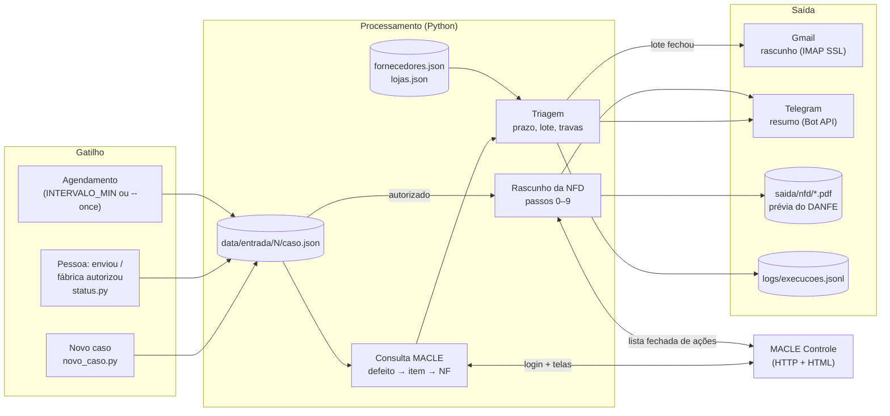
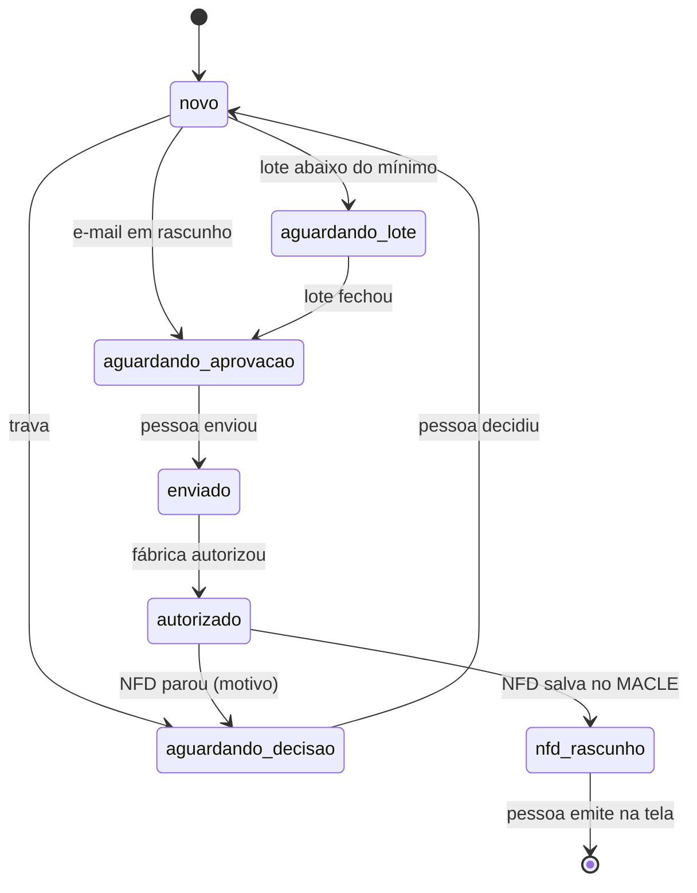

# Automação de devoluções de produtos com defeito (ERP MACLE)

Automação em Python para lojas de calçados que usam o ERP **MACLE Controle**. Ela cuida da devolução à fábrica de produtos com defeito:
- lê no MACLE o defeito, o item e a nota fiscal de compra;
- aplica as regras de cada fábrica (prazo de garantia, lote mínimo);
- deixa o e-mail de devolução pronto no Gmail;
- depois que a fábrica autoriza, monta o **rascunho da NFD** (nota fiscal de devolução) no próprio MACLE;
- avisa o responsável no Telegram a cada passo.

> Roda em produção numa rede de lojas desde outubro de 2026. Este repositório é a versão pública: nomes, CNPJs e e-mails são **fictícios**. Para a demo e os testes há um **simulador do MACLE** (`mock_macle/`) que serve as mesmas telas do sistema real, com dados inventados.

---

## 1. Sobre o projeto e problema resolvido

**A dor.** O cliente devolve um par com defeito de fábrica e a loja precisa cobrar a fábrica. À mão, o processo era assim:
1. o gerente cadastra o defeito no MACLE e avisa por WhatsApp;
2. alguém procura no MACLE de qual nota fiscal e de qual fábrica o par veio, e quanto custou;
3. confere na política daquela fábrica se ainda está no prazo e se já há pares suficientes para o lote mínimo;
4. escreve o e-mail com referência, numeração, NF e fotos de cada par;
5. quando a fábrica autoriza, monta a NFD no MACLE, tela por tela: fornecedor, defeitos, NF de origem, item da nota, transporte e pesos.

Com várias lojas e dezenas de fábricas, cada uma com uma regra, os casos se perdiam: o prazo vencia esperando o lote fechar, a NFD saía com o item errado da nota ou o par ficava esquecido na estante.

**O que a automação faz:**
- Cada caso vira um arquivo JSON.
- A cada rodada, a automação consulta o MACLE, agrupa os casos por loja e fábrica, aplica as regras e prepara o e-mail.
- Depois da autorização da fábrica, faz a NFD no MACLE até o "Continuar depois".
- A pessoa só **revisa e envia o e-mail** e **confere e emite a NFD**. Emitir a nota no SEFAZ continua sendo sempre humano.

**Ganho prático:**
- nenhum caso fica sem dono;
- os dados vêm do ERP, sem redigitar;
- prazo e lote mínimo são conferidos por regra;
- a NFD já chega pronta e com a prévia do DANFE conferida;
- falhas de sistema chegam na hora no celular.

<!-- TODO (Angelo): número real de ganho, ex.: "antes ~X h/semana, hoje ~Y min; N casos desde out/2026". -->

---

## 2. Arquitetura e fluxo de funcionamento



**Caminho dos dados (Gatilho → Processamento → Saída):**

1. **Gatilho.**
   - O `defeitos/main.py` roda uma rodada a cada `INTERVALO_MIN` minutos, ou uma vez com `--once`.
   - Casos entram por `novo_caso.py`, que faz o papel da recepção do WhatsApp em produção.
   - O que a pessoa faz fora do sistema (enviou o e-mail, a fábrica autorizou) é marcado com `status.py`.
2. **Consulta no MACLE** (`defeitos/macle/`). O MACLE **não tem API**: a automação faz o mesmo caminho que a pessoa faz na tela e lê o HTML.
   - Login com empresa, terminal, usuário e senha, e cookie de sessão.
   - Filtro de defeitos pelo item, para achar o defeito em aberto do tamanho.
   - Telas do defeito e do item.
   - Histórico de compras, para escolher a NF pela ordem de lojas do `lojas.json`.
   - Documento de compra: CNPJ do fornecedor, emissão e custo.

   Cada tela tem uma função de leitura em `telas.py`, e o resultado vai para o `caso.json`.
3. **Triagem** (`triagem.py`). Acha a fábrica pelo CNPJ da NF e decide:
   - sem cadastro ou sem e-mail → **trava**, o caso vai para decisão humana;
   - fora do prazo → **não trava**: o assunto do e-mail ganha "fora do prazo" e a fábrica decide;
   - casos da mesma loja da NF e da mesma fábrica formam um **lote**, que só vira e-mail ao atingir o mínimo em R$ e em pares.
4. **E-mail.** O `gmail.py` grava o rascunho, com as fotos anexadas, na pasta Rascunhos por IMAP. **Nunca envia.**
5. **NFD** (`macle/nfd.py`). Casos `autorizado` da mesma loja e fábrica viram uma NFD:
   - abre a devolução, marca os defeitos e escolhe a NF de origem;
   - associa cada par à linha certa do XML da nota (referência → tamanho → cor; se ficar ambíguo, **para e pergunta**);
   - preenche transporte e pesos;
   - gera a **prévia do DANFE** e confere CNPJs, CFOP, itens, valor, transportadora e pesos;
   - só então grava em "Continuar depois".
6. **Resumo.** O Telegram recebe o que mudou na rodada, e cada rodada vira uma linha em `logs/execucoes.jsonl`.

**Ciclo de vida de um caso** (só as transições de `casos.py` são aceitas):



### Segurança no ERP
O usuário do MACLE pode alterar dados. Por isso a sessão (`macle/sessao.py`) só aceita uma **lista fechada** de endereços e ações:
- só leitura nas consultas;
- o mínimo da devolução até "Continuar depois";
- **emitir no SEFAZ, cancelar, excluir e carta de correção não estão na lista** e são recusados antes de sair da máquina;
- redirecionamentos só são seguidos para dentro da mesma lista;
- se a sessão cai no meio da NFD, o processo para (não refaz o login e continua um documento pela metade).

### Resiliência e tratamento de erros
| Situação | Comportamento |
|---|---|
| Timeout, conexão recusada, HTTP 5xx ou 429 | **retry com backoff** (1 s, 2 s, 4 s…) até `TENTATIVAS`; cada tentativa vai para o log |
| Senha errada ou ação fora da lista | **não repete** (repetir não muda o resultado): erro claro na hora |
| Sessão do MACLE expirou (consulta) | novo login automático e repete a tela uma vez |
| MACLE fora do ar | os casos ficam para a próxima rodada e o Telegram recebe "🚨 Falha: MACLE…" |
| Tela com formato inesperado, item ambíguo, DANFE divergente | a NFD **não é gravada**; o caso vai para `aguardando_decisao` com o motivo |
| Já existe rascunho de NFD do mesmo fornecedor | não cria outro (a pessoa decide) |
| `caso.json` quebrado | ignorado com motivo no resumo; os outros seguem |
| Rodar de novo | **idempotente**: o status anda e o rascunho de e-mail tem Message-ID fixo por lote |
| Erro inesperado | traceback no log (com segredos mascarados), aviso no Telegram, e o agendamento continua |

---

## 3. Tecnologias e APIs utilizadas

| Camada | Tecnologia |
|---|---|
| Linguagem | Python 3.10+ |
| ERP | MACLE Controle por HTTP: `requests.Session` (cookie, timeout, sem redirecionamento automático), leitura de HTML com `re` |
| PDF | leitura do DANFE (streams `FlateDecode` com `zlib`) para conferência |
| E-mail | `imaplib` + `ssl` (IMAP4 sobre TLS, porta 993), `email` (MIME com anexos) |
| Mensageria | Telegram Bot API (`sendMessage`, HTTPS) |
| Dados | JSON (casos, `fornecedores.json`, `lojas.json`, log JSONL) |
| Credenciais | `.env` + `python-dotenv` |
| Simulador | `http.server` (biblioteca padrão): telas do MACLE, sessão, NFD e prévia do DANFE |
| Containers | Docker + Docker Compose (opcional) |
| Testes | `unittest`: 27 testes contra o simulador, mais 3 de fidelidade com páginas reais |

**Autenticação:**
- MACLE: formulário de login com usuário e senha e cookie de sessão;
- Gmail: IMAP com **senha de app**;
- Telegram: **token do bot**.

Nada disso está no código: vem do `.env`, que fica fora do git. A `Config` não imprime segredos, e as mensagens de erro passam por `esconder()` antes de ir para o log ou para o Telegram.

---

## 4. Pré-requisitos e como executar

**Pré-requisitos:**
- Python 3.10+.
- Para usar na sua loja: acesso ao MACLE Controle pela rede da loja e um usuário com permissão nas telas de Defeito, Item, Compras e Devolução ao Fornecedor.
- Opcional: Gmail com [senha de app](https://myaccount.google.com/apppasswords) e um bot do Telegram criado no [@BotFather](https://t.me/BotFather).

Sem Gmail ou Telegram configurados, a automação roda em **modo arquivo**: os rascunhos vão para `saida/rascunhos/*.eml` e o resumo para `saida/telegram.log`.

### Rodar a demo (simulador)

1. Instalar as dependências:

```powershell
python -m venv .venv
.venv\Scripts\activate
pip install -r requirements.txt
```

2. Criar o `.env` a partir do exemplo:

```powershell
copy .env.example .env
```

3. Subir o simulador num terminal separado:

```powershell
python mock_macle\servidor.py
```

4. Criar os casos de exemplo e rodar uma vez:

```powershell
python -m defeitos.novo_caso --reset
python -m defeitos.main --once
```

Sem `data/lojas.json`, a automação usa `data/lojas.exemplo.json`, que aponta para o simulador. Com Docker, `docker compose up --build` sobe o simulador e a automação juntos.

### Usar no MACLE da sua loja
1. **`.env`**: o login de verdade em `MACLE_USUARIO`, `MACLE_SENHA` e `MACLE_TERMINAL`. Opcionalmente, `PESO_POR_PAR` e `PESO_CAIXA` para a NFD.
2. **`data/lojas.json`** (fora do git): copie o `lojas.exemplo.json` e preencha:
   - para cada loja: número, CNPJ, razão social e `servidor`, a URL do MACLE que atende a loja (ex.: `http://IP-DO-SERVIDOR:8080/Controle/`);
   - `consulta`: a loja usada no login das consultas;
   - `ordemLojas`: a preferência para escolher a NF de compra.
3. **`data/fornecedores.json`**: as fábricas com quem você trabalha (CNPJ, e-mail de devolução, prazo, lote mínimo, transportadora). É o conhecimento do seu setor sobre cada fábrica.
4. Rode `python -m defeitos.main --once` e confira o resumo. Para deixar agendado, rode `python -m defeitos.main` ou use o Agendador de Tarefas / cron com `--once`.

### Testes

```bash
python -m unittest discover -s tests -t .
```

**Fidelidade ao MACLE real:** salve páginas do seu MACLE numa pasta fora do repositório (`defeito.html`, `item.html`, `historico.html`, `documento.html`, `lista.html`, `filtro.html`…) e rode:

```bash
MACLE_FIXTURES=/caminho/das/paginas python -m unittest tests.test_telas_reais
```

### Roteiro da demo
1. `python -m defeitos.novo_caso --reset` e `python -m defeitos.main --once`:
   - o e-mail da Passo Firme fica pronto;
   - o lote da Aurora espera (faltam R$ 80,20);
   - a Trilha vai para decisão.
2. Chega um par novo: `python -m defeitos.novo_caso --loja 1 --codigo 1.1001.38 --defeito "Salto soltando"`, depois `--once`.
   - O lote da Aurora fecha e o e-mail sai com "fora do prazo" no assunto.
3. A pessoa envia o e-mail e a fábrica autoriza:

```bash
python -m defeitos.status --protocolos 1,2,6 --para enviado
python -m defeitos.status --protocolos 1,2,6 --para autorizado
```

   - Rodar `--once` de novo: a NFD fica em rascunho no MACLE e a prévia do DANFE é salva em `saida/nfd/`.
4. Simular o MACLE fora do ar: `python mock_macle\simular.py 503 5`, registrar um caso e rodar `--once`.
   - O log mostra 3 tentativas e o Telegram recebe o alerta.
   - Depois, `python mock_macle\simular.py normal`.

---

## 5. Demonstração (resultados)

Saída real das quatro rodadas do roteiro (console e mensagem do Telegram):

```text
📦 Defeitos — rodada de 09/11 14:20
✉️ Rascunho pronto para revisar: Passo Firme Tênis (loja 6), 3 pares, R$ 477,00, casos #3, #4
⏳ Lote Aurora Calçados (loja 1): R$ 219,80, faltam R$ 80,20 (mínimo R$ 300,00)
⛔ Caso #5 precisa de decisão: Trilha Botas: sem e-mail de contato cadastrado

📦 Defeitos — rodada de 09/11 14:20
✉️ Rascunho pronto para revisar: Aurora Calçados (loja 1), 3 pares, R$ 349,70, casos #1, #2, #6
   ⚠️ #2: fora do prazo (12 meses da NF de 15/08/2025: vence em 15/08/2026)

📦 Defeitos — rodada de 09/11 14:20
🧾 NFD em rascunho no MACLE: Aurora Calçados (loja 1), R$ 349,70, casos #1, #2, #6. Conferir e emitir na tela.

📦 Defeitos — rodada de 09/11 14:20
🚨 Falha: MACLE: HTTP 503 em página de login (depois de 3 tentativas)
   1 caso(s) ficam para a próxima rodada.
```

<!-- TODO (Angelo): adicionar em docs/img/ e trocar por imagens: o resumo no Telegram, o rascunho no Gmail e a prévia do DANFE. -->

---

## 6. Melhorias futuras (roadmap)

1. **Ler a resposta da fábrica no Gmail.** Hoje a autorização é marcada com `status.py`. A próxima etapa é detectar a resposta e classificá-la (autorizou, recusou, pediu dados) com um LLM via API, com saída JSON validada por esquema e conferida antes de qualquer ação.
2. **Acompanhar a NFD emitida.** Detectar no MACLE quando a pessoa emite a nota, baixar o XML autorizado e o DANFE oficial e preparar o e-mail de resposta à fábrica com os anexos.
3. **Painel e fim do ciclo.** Um painel web com os casos parados há mais tempo em cada etapa, incluindo o envio do produto e o ressarcimento da fábrica.
