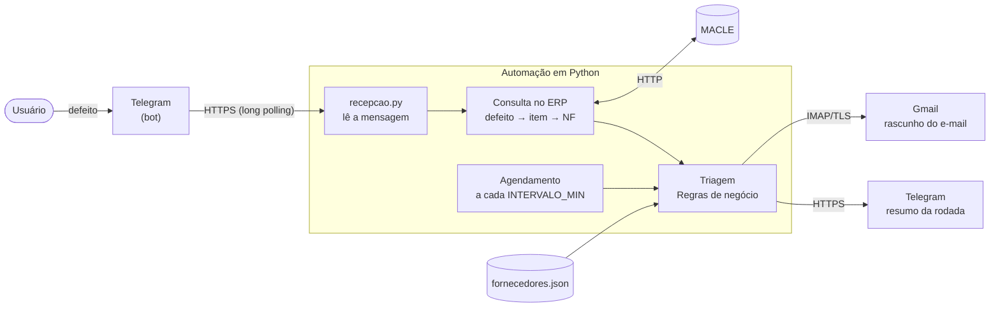

# Automação de devoluções de produtos com defeito (ERP MACLE)

### Sobre o Projeto

Automatiza o início do processo de devolução de produtos com defeito, do recebimento do caso até o rascunho do e-mail para a fábrica.

1. **Recebe o caso pelo Telegram** (Usuário): Envio para o bot a foto do defeito com o código do produto na legenda.
2. **Consulta o MACLE**: acha os dados do produto, a nota fiscal de compra, a fábrica e o custo, com uma consulta no ERP.
3. **Aplica as regras de cada fábrica**: prazo de garantia e lote mínimo (em R$ e em pares).
4. **Prepara o e-mail de devolução**: cria o rascunho no Gmail, pronto para o envio.
5. **Avisa no Telegram**: confirma cada caso registrado e manda um resumo.

### Sobre o problema

Hoje, iniciar o processo de devolução de um produto com defeito é mais complicado do que parece. Cada fábrica tem a sua própria política de devolução, e o prazo de garantia e o lote mínimo mudam de uma para outra. Além disso, a fábrica costuma pedir a nota fiscal de origem para comprovar que o produto está dentro do prazo, é preciso saber o e-mail de devolução de cada uma, e não existe um passo a passo documentado por fábrica.

Isso dá trabalho para quem precisa iniciar o processo: a pessoa tem que levantar e conferir todas essas informações à mão, o que abre espaço para o erro humano.

Essa automação visa ajudar quem estiver inciando este processo, pois se o produto estiver cadastrado no sistema, basta o código do produto e numeração, fazendo uma consulta automatizada, filtrando a fábrica a partir dos dados coletados e criando o rascunho no padrão deles.

---

### Arquitetura e fluxo

1. **Gatilho**: Produto com defeito é enviado pelo telegram
2. **Processamento**: Consulta na MACLE por HTTP, fazendo scraping (sem API) e aplica as regras fábrica
3. **Saída.** Cria o rascunho no gmail com as fotos anexadas, na pasta Rascunhos por IMAP. Além disso, envia um resumo no Telegram



---

### Tecnologias

Tecnologias: Python, Docker, unittest.
<br>
Serviços: MACLE, Gmail, Telegram (Bot).
<br>
Bibliotecas: imaplib, ssl, requests.

---


## Como rodar

**1. Baixar o projeto**

```bash
git clone https://github.com/angelofonseca/automacao-devolucoes-macle.git
cd automacao-devolucoes-macle
```

**2. Criar o ambiente virtual e instalar as dependências**

```bash
python3 -m venv .venv
source .venv/bin/activate
pip install -r requirements.txt
```

**3. Criar e preencher o `.env`**

```bash
cp .env.example .env
```

Preencha no `.env`:
- **Gmail**: `GMAIL_USER` com a sua conta e `GMAIL_APP_PASSWORD` com a senha de app.
- **Telegram**: `TELEGRAM_BOT_TOKEN` com o token que o @BotFather dá. Para achar o `TELEGRAM_CHAT_ID`, mande qualquer mensagem ao bot e abra `https://api.telegram.org/bot<TOKEN>/getUpdates`: o número está em `"chat": {"id": ...}`. Só esse chat registra casos e recebe os resumos.
- **MACLE**: para a demo, não precisa de nada. O simulador aceita qualquer login e já vem com a loja 1 (`data/loja.exemplo.json`).

**4. Subir o simulador do MACLE** (num terminal separado, com o ambiente virtual ativo)

```bash
python mock_macle/servidor.py
```


**5. Subir a automação**

```bash
python -m defeitos.main
```

**6. Mandar as fotos ao bot**

No Telegram, abra o chat com o seu bot e mande **uma foto por defeito com o código do produto na legenda. A legenda aceita dois formatos:
- **item com tamanho**: `loja.item.tamanho`, ex.: `1.2001.40`;
- **código do defeito no MACLE**: `loja.número`, ex.: `1.60000003`.


#### Exemplos

| Legenda (item.tamanho) | ou código do defeito | Produto | Fábrica | Pares no defeito |
|---|---|---|---|---|
| `1.2001.40` | `1.60000003` | Tênis casual PF-880 branco | Passo Firme | 1 |
| `1.2001.42` | `1.60000004` | Tênis casual PF-880 branco | Passo Firme | 2 |
| `1.1001.37` | `1.60000001` | Scarpin AU-2041 preto | Aurora | 1 |
| `1.1002.36` | `1.60000002` | Sandália AU-3310 caramelo | Aurora | 1 |
| `1.1001.38` | `1.60000006` | Scarpin AU-2041 preto | Aurora | 1 |
| `1.1001.36` | `1.60000008` | Scarpin AU-2041 preto | Aurora | 1 |
| `1.3001.39` | `1.60000005` | Bota TR-120 café | Trilha | 1 |
| `1.9001.40` | `1.60000007` | Mocassim MN-01 azul | Marca Nova | 1 |

Cada par só pode ser registrado **uma vez**: o `1.2001.42` aceita duas fotos e os outros códigos, uma. As regras de cada fábrica estão em `data/fornecedores.json`:
- **Passo Firme**: o e-mail sai quando o lote chega a **3 pares**;
- **Aurora**: o e-mail sai quando o lote chega a **R$ 300,00**, e a garantia é de **12 meses da NF**: o que passou disso trava;
- **Trilha**: está cadastrada **sem e-mail**, então o caso trava;
- **Marca Nova**: **não está cadastrada**, então o caso trava.

### Casos travados

Caso travado (fora do prazo, fábrica sem cadastro ou sem e-mail, defeito não encontrado no MACLE) fica em `aguardando_decisao`, com o motivo no resumo do Telegram. Depois de resolver (ex.: cadastrar o e-mail da fábrica no `data/fornecedores.json`), reabra o caso para ele voltar à triagem na próxima rodada:

```bash
python -m defeitos.status               # status de todos os casos
python -m defeitos.status --reabrir 5   # o caso 5 volta para a triagem
```

### Testes

Os testes usam o simulador e um Gmail e um Telegram falsos, então não precisam de rede nem do `.env`:

```bash
python -m unittest discover -s tests -t .
```

**Fidelidade ao MACLE real:** salve páginas do seu MACLE numa pasta fora do repositório (`defeito.html`, `item.html`, `historico.html`, `documento.html`, `lista.html`, `filtro.html`) e rode:

```bash
MACLE_FIXTURES=/caminho/das/paginas python -m unittest tests.test_telas_reais
```

---

### Melhorias futuras

1. **Acompanhar o envio e a resposta da fábrica** (próximo passo). Detectar no Gmail que a pessoa enviou o e-mail e classificar a resposta da fábrica (autorizou, recusou, pediu dados), com um LLM via API, saída JSON validada por esquema e conferida antes de qualquer ação.
2. **NFD.** Depois da autorização, preparar a nota fiscal de devolução no MACLE e, quando a pessoa emitir, mandar o XML e o DANFE à fábrica.
